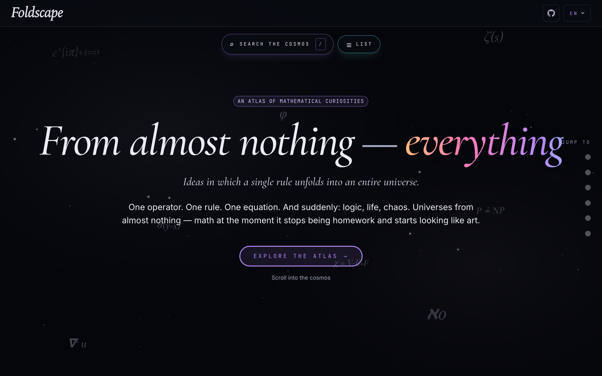
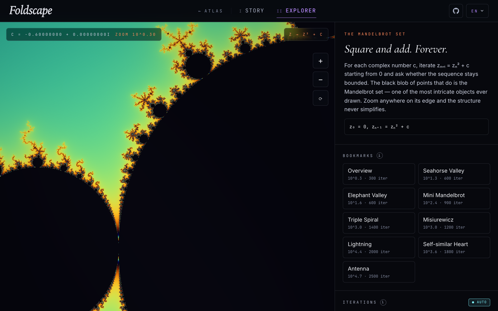

<div align="center">

# Foldscape

**An atlas of mathematical curiosities**

From almost nothing, everything. Foldscape is a multilingual, interactive atlas
of mathematical ideas in which something almost trivially small generates
something absurdly intricate. Built for anyone who has ever stopped because a
formula was beautiful: the curious teenager, the working scientist, the teacher
looking for a story to tell.

[**Open the atlas**](https://foldscape.zauberware.com) ·
[License: CC BY 4.0](LICENSE) ·
[Contributing](CONTRIBUTING.md) ·
[Report something wrong](https://github.com/simonfranzen/foldscape/issues)

<br>

[](https://foldscape.zauberware.com)

</div>

---

## What is inside

**48 rooms.** Every room is a long-form story plus its own interactive
playground, and every room ships in **8 languages**: English, German, Spanish,
French, Italian, Portuguese, Swedish, Norwegian.

| Category            | Rooms                                                                                                                                                                                                                   |
| ------------------- | ----------------------------------------------------------------------------------------------------------------------------------------------------------------------------------------------------------------------- |
| **Logic** (2)       | Sheffer stroke (NAND), Boolean satisfiability                                                                                                                                                                           |
| **Computation** (9) | Conway's Game of Life, Iota combinator, Rule 110, Wang tiles, Boids, Langton's ant, halting problem, P vs NP, RSA                                                                                                       |
| **Chaos** (10)      | Mandelbrot set, logistic map, Lorenz attractor, Collatz conjecture, double pendulum, Belousov-Zhabotinsky reaction, diffusion-limited aggregation, Aizawa attractor, magnetic pendulum, diffusion models                |
| **Geometry** (10)   | L-systems, Sierpiński triangle, chaos game, Penrose tilings, Apollonian gaskets, golden ratio, Pascal's triangle mod _n_, coffee-cup cardioid, Möbius strip and Klein bottle, Euler characteristic                      |
| **Analysis** (12)   | Fourier transform, Euler's identity, Turing patterns, Buffon's needle, Stern-Brocot tree, Ulam spiral, Galton board, Königsberg bridges, four colour theorem, small-world networks, backpropagation, Riemann hypothesis |
| **Paradox** (5)     | Banach-Tarski, Hilbert's hotel, Gabriel's horn, Cantor's diagonal, Gödel's incompleteness                                                                                                                               |

No account, no tracking, no cookies. The interactive rooms run entirely in your
browser on Canvas 2D, WebGL and SVG.

[](https://foldscape.zauberware.com/mandelbrot/explorer)

<div align="center"><sub>Every room pairs a story with a playground. This one is
<a href="https://foldscape.zauberware.com/mandelbrot/explorer">the Mandelbrot
explorer</a>, zoomable to the limits of double precision.</sub></div>

## Stack

- [Next.js 15](https://nextjs.org) (App Router) and React 19
- TypeScript in strict mode
- Tailwind CSS
- Canvas 2D, WebGL and SVG for every visualisation, no heavyweight viz library
- KaTeX for formulas, with the hot font variants self-hosted so formulas do not
  flash on first paint
- Vitest and Testing Library for the test suite

## Quick start

```bash
git clone https://github.com/simonfranzen/foldscape
cd foldscape
npm install
npm run dev
```

Open <http://localhost:3000>. Hot reload covers everything, i18n changes
included.

| Command             | What it does                                                     |
| ------------------- | ---------------------------------------------------------------- |
| `npm run dev`       | Dev server                                                       |
| `npm run build`     | Production build, also the gate before calling a big change done |
| `npm run typecheck` | `tsc --noEmit`, strict mode, the bar for any edit                |
| `npm test`          | Vitest suite under `tests/`                                      |
| `npm run lint`      | ESLint 9, flat config                                            |
| `npm run format`    | Prettier, including Tailwind class ordering                      |

CI runs typecheck, lint, tests, the Prettier check and the production build on
every push and pull request.

## Project structure

```
app/                       # Next.js routes
  page.tsx                 # The atlas itself, a scroll-driven constellation
  sitemap.ts, robots.ts    # Generated for all routes, with hreflang alternates
  <topic>/page.tsx         # Long-form story
  <topic>/layout.tsx       # Canonical URL, title, description, hreflang
  <topic>/explorer/        # Interactive playground (some rooms call it
                           # sandbox, simulator, builder, reducer or sound)
components/                # Shared UI plus the inline interactive demos
  StoryPageShell.tsx       # Hero and closing call to action
  signature/               # Per-topic hero artefacts
  cosmos/                  # The landing-page star field
lib/
  topics.ts                # Topic registry: id, route, category, glyph, formula
  topicEdges.ts            # Curated affinities between topics
  seo/routes.ts            # Route inventory the sitemap builds on
  og/metadata.ts           # Canonical, title and hreflang helpers
  i18n/
    types.ts               # Locale union and detection
    context.tsx            # Provider, reads ?lang= and localStorage
    atlas.ts               # Landing copy and topic cards (8 languages)
    messages.ts            # Nav, footer, hero, section labels (8 languages)
    stories.ts             # Shared long-form stories
    stories.<locale>.ts    # Per-locale long-form stories
tests/                     # Data invariants, pure utilities, render smoke
```

## How the languages work

The locale lives in a `?lang=<locale>` query parameter, for example
`/lorenz?lang=de`. It overrides browser detection and is mirrored into the URL
when someone picks a language, so links stay shareable. English is the default
and the bare path.

Longer per-topic prose sits inline in the topic page as a
`RICH_STORY: Record<Locale, RichStory>` constant, shorter blurbs live in the
shared bundles under `lib/i18n/`. Both patterns coexist on purpose: pages with a
lot of locale-specific prose keep it local, small pages stay on the shared
bundles.

German prose follows gender-neutral conventions, so _Studierende_ rather than
_Studenten_, _Mathematiker:innen_ rather than _Mathematiker_.

## Adding a room

1. Add the new `TopicId` in `lib/topics.ts` and append a `TOPICS` entry with
   `id`, `href`, `status`, `category`, `glyph`, `formula` and `sections`.
2. Optionally add affinity edges in `lib/topicEdges.ts` so the room finds its
   place in the constellation.
3. Add a short blurb to `lib/i18n/placeholders.ts` (the English fallback) and a
   localised version in each locale block of `lib/i18n/atlas.ts`.
4. Create `app/<topic>/page.tsx`, starting from `app/apollonian/page.tsx` for a
   simple room or `app/banach/page.tsx` for the full inline `RICH_STORY`
   pattern, wrapped in `StoryPageShell`.
5. Create `app/<topic>/layout.tsx` with `topicMetadata("<topic>")` and
   `app/<topic>/explorer/layout.tsx` with `topicSubpageMetadata(...)`, then
   register the sub-room in `lib/seo/routes.ts` so it reaches the sitemap.
6. Create `app/<topic>/explorer/page.tsx` and put custom demo components under
   `components/`.
7. Run `npm run typecheck` and `npm test`. The data-invariant test will tell you
   if a locale, an atlas card or a story page is missing.

## Improving a translation

- Hero and section copy: the relevant locale inside the topic page's
  `RICH_STORY` in `app/<topic>/page.tsx`.
- Atlas card title, tagline and blurb: the topic's entry in the locale block of
  `lib/i18n/atlas.ts`.
- Navigation, footer and shared labels: `lib/i18n/messages.ts` and
  `lib/i18n/ui.ts`.

Translation fixes are the most welcome kind of pull request. Six of the eight
locales were seeded from a smaller base, so there is real work to do there.

## Accessibility and motion

Formulas render as MathML alongside KaTeX output and carry a spoken-form
`aria-label`. Every animated canvas honours `prefers-reduced-motion` and falls
back to a static frame. There is a skip link, a visible focus ring throughout,
and the four colour theorem room uses hatch patterns so it still reads with
protanopia.

## Contributing

See [CONTRIBUTING.md](CONTRIBUTING.md). Bug reports and pull requests are
welcome, especially new rooms, translation improvements and visualisation
upgrades. If something is mathematically wrong, sloppy or misleading, please say
so in an issue, that is the most useful thing you can send.

## License

[CC BY 4.0](LICENSE). Share it, remix it, build on it, teach with it, just
credit the project.

Curated by [Simon Franzen](https://github.com/simonfranzen) at
[zauberware](https://www.zauberware.com).
